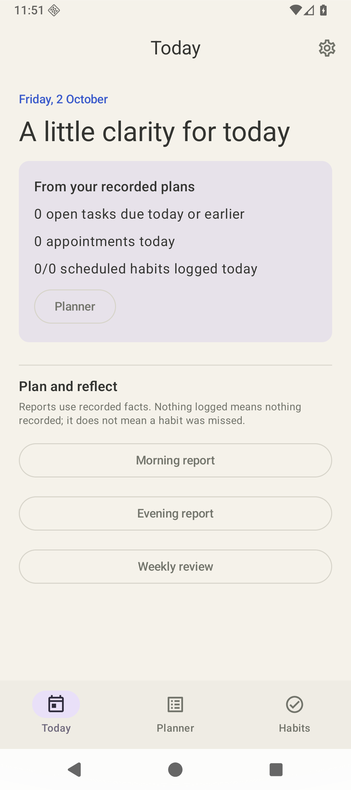
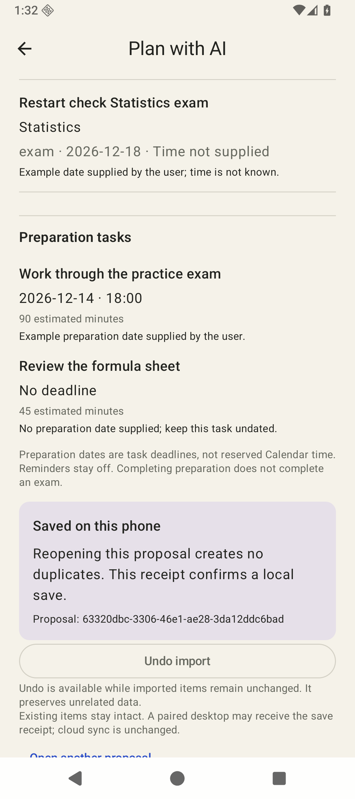

# Habits for Android

**0.1.0 development preview** · Android 8.0 or newer

A native Android app for keeping daily work, appointments, habits and semester deadlines together. Add a task, log a habit, or turn an exam timetable into a proposal you can review before saving. Your planning data stays on your phone unless you choose to export or share it.

This is a small, working starting point for continued development. It is not yet a production release or a complete counterpart to the iPhone app.

## What you can do

- **Today:** see recorded deadlines, appointments and scheduled habits in one place.
- **Planner:** create and edit tasks, assignments and appointments; review semester exams and deadlines; keep preparation separate from exam completion.
- **Habits:** choose scheduled days, record today's completion and retain logs when archiving a routine.
- **Reports:** open Morning, Evening and Weekly summaries generated offline from recorded facts. Missing logs are not treated as missed habits, and estimated work is not reported as time studied.
- **Settings:** choose English, German or Spanish, switch appearance, export a local backup and restore the previous local backup when available.

<p>
  
  
</p>

## Try the preview

Download the [0.1.0 release](https://github.com/ravel7524/habits-android/releases/tag/v0.1.0) or the [APK directly](https://github.com/ravel7524/habits-android/releases/download/v0.1.0/habits-android-0.1.0-debug.apk).

1. Open the downloaded APK on your phone.
2. If Android asks, allow **Install unknown apps** for the browser or Files app you used to open it. This permission applies to that app; the exact labels vary by phone. [Google's installation guidance](https://support.google.com/pixelphone/answer/7391672?hl=en) explains the setting.
3. Install Habits, then turn that installation permission off again if you no longer need it.
4. Start with a task in **Planner** or a routine in **Habits**. Neither requires an account or an AI connection.

This APK is a **debug-signed development build**, not a Play Store release. Its SHA-256 is:

```text
a991254265b9aa0c7292e81c97f4e83f163a655d9c8bf6f335ad9743af53b9ba
```

Before trying another build, export a backup in Settings and keep it somewhere safe. Exports contain private records and notes. **Do not uninstall to work around an update failure:** uninstalling removes local app data.

Signing continuity for this preview is not yet established: compatible updates require recovery of a retained private copy of the original signing key. Do not assume a future APK can update this installation in place. Stable release signing needs further work before routine upgrades.

## Plan an exam with an assistant

For example, you have a Statistics exam on **20 January 2027 at 09:00, Europe/Zurich**, and want an undated task called **Review statistics**.

Open **Planner → Semester → Plan with AI**. Share the instructions with your chosen assistant and give it the original timetable. Open its JSON proposal, or paste it, then check the course, exam date, time zone and preparation. Nothing is added until you select **Confirm and save**. The exam appears in Semester and the preparation appears in Work. Completing preparation does not complete the exam.

The same proposal can be opened again without creating duplicates. **Undo import** is guarded: it is available while the imported records remain unchanged and have no new dependent records. It preserves unrelated work and keeps a receipt that the proposal was undone.

File and paste import work without a desktop connection. For a connected Codex or Claude workflow, install the separate [Habits MCP project](https://github.com/ravel7524/habits-mcp), then use **Connect Codex or Claude** on the phone. Pairing requires a reachable private desktop address. You choose a semester before sharing its academic context; the phone discloses included assessment notes and recorded states. The assistant may send shared context to its AI provider.

Developers can inspect the [proposal format and synthetic example](docs/contracts/README.md).

A connected assistant can stage additions, but the phone still owns review and confirmation. A staged proposal is not a successful save. The paired desktop receives an applied or undone receipt after the phone changes its local records; unavailable receipt delivery is retried on manual refresh. Version 1 does not give assistants arbitrary app-code, screen-editing or deletion commands.

## Current limits and verification

There is no automatic cross-platform sync. This preview does not provide the iPhone app's on-device LLM, widgets, external Calendar integration, notification delivery or CloudKit features.

The published APK is the build tested on **3 October 2026**: 65 portable tests and five Compose workflows passed. An Android emulator also completed real private desktop pairing, proposal retrieval, phone review/save, receipt refresh, restart and file-based Undo followed by an undone desktop receipt. All 65 portable tests also passed from this standalone repository on 5 October 2026. [The first CI run](https://github.com/ravel7524/habits-android/actions/runs/37318116223) also passed the portable tests and compiled the app and test APKs. Publication does not constitute a fresh emulator run of every workflow.

Physical phones and real LAN routing remain untested. Android runtime checks used adb, UI inspection and logs; Android LLDB attachment was unavailable. These results establish the tested emulator paths, not physical-device acceptance.

## Develop

Use **JDK 21** and the checked-in Gradle wrapper. App builds also need Android SDK platform 37, build tools 36.0.0 and platform-tools, with the SDK licenses accepted in your own environment. Set your SDK location through `ANDROID_HOME` or a local, untracked `local.properties` file.

```sh
./gradlew -PcoreOnly=true :core:test
./gradlew :app:assembleDebug :app:assembleDebugAndroidTest
./gradlew :app:connectedDebugAndroidTest
```

The first command needs no Android SDK. The last command needs a running emulator or connected test device. UI tests use isolated synthetic stores. Toolchain versions are Gradle 9.3.1, Android Gradle Plugin 9.1.1 and Kotlin 2.4.10; compile SDK 37, target SDK 36 and minimum SDK 26.

See [Contributing](CONTRIBUTING.md), [Architecture](docs/ARCHITECTURE.md) and the tentative [Roadmap](ROADMAP.md).

## License status

No project license has been selected yet. Third-party components remain subject to their respective [licenses and notices](docs/licenses/README.md).
