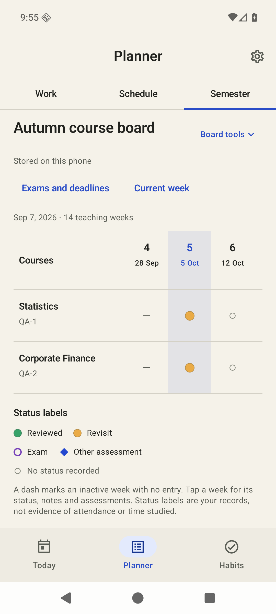
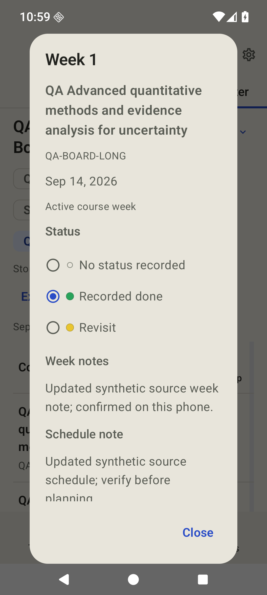

# Habits for Android

**0.5.0 development preview** · Android 8.0 or newer

A native Android app for daily work, appointments, habits and a course-week Semester Board. Import your timetable or review an assistant's proposal before saving it, or use the planner independently. Your records stay on the phone unless you explicitly export or share them.

## Download

Get the [0.5.0 preview](https://github.com/ravel7524/habits-android/releases/tag/v0.5.0) or [download the APK](https://github.com/ravel7524/habits-android/releases/download/v0.5.0/habits-android-0.5.0-debug.apk). The release includes checksums and a manifest. This is a debug-signed development build, not a Play Store release.

Open the APK with Android's browser or Files app. If asked, permit **Install unknown apps** for that app, then turn that permission off after installation. [Google's installation guidance](https://support.google.com/pixelphone/answer/7391672?hl=en) explains the setting; labels vary by device. Tasks and habits need no account or AI connection.

**Existing installations:** 0.5 retains the separately held 0.2–0.4 development certificate, permitting same-package updates in place. It uses a different certificate from public 0.1 and cannot update 0.1 in place. Export and retain your private backup before changing installations; uninstalling removes local data. Stable release signing and a supported 0.1 migration remain open.

## Daily use

- **Today:** open deadlines, saved appointments and scheduled habits before report entry.
- **Planner:** tasks/assignments, appointments and a Semester Board with separate preparation. Native date/time pickers preserve date-only work. Review, then Confirm before saving.
- **Habits:** scheduled days, daily completion and retained logs/archive history. Missing logs are unknown, not inferred misses.
- **Reports:** offline Morning, Evening and Weekly summaries from saved facts. Estimated minutes describe planned work, not time studied.
- **Calendar:** optional read-only access to calendars you select; events stay out of assistant context.
- **Notifications:** explicit permission and per-type opt-ins, quiet hours and Snooze; Android can delay inexact delivery. Report invitations do not run AI in the background.
- **Widgets:** Next up and Today's habits use local records; titles can be seen by anyone viewing the home screen.
- **Settings:** English/German/Spanish, appearance, local backup/recovery, archived history and optional device tools.

<p>
  
  
</p>

## Semester Board

Open **Planner → Semester**. On a populated board, **Board tools → Import semester JSON** opens a raw iPhone `semester.json` file or a typed assistant proposal. The empty board shows its import actions directly. Check included courses, dates/time zone, notes and changes before **Confirm and save**.

- Fixed course names/module codes beside horizontally scrolling source-relative weeks, current-week navigation and custom status labels/colors.
- Week details with recorded status and read-only source notes; exam/deadline markers and an all-assessments list, including completed, dismissed and out-of-grid dates.
- Reviewed merges preserve omitted records/history and later edits. A fresh review is required after source changes; reopening a consumed import creates no duplicates.
- Separate preparation drafts from a week or assessment: undated, zero estimate, and saved only after review/Confirm. Completing preparation does not mark a week or assessment complete.

**Workspace upgrade:** schema 1 is read into schema 2 without rewriting its original file. The first deliberate edit retains an exact dedicated `workspace.json.schema-v1-backup`; subsequent edits preserve it alongside the rolling backup. Existing records and import receipts remain. **Downgrading an edited schema-2 workspace to 0.4 or earlier is unsupported.** Keep private version-specific exports/recovery files before changing installations. [Contracts, migration and scenarios](docs/ANDROID-SEMESTER-BOARD.md).

## Plan with Codex or Claude

Use **Planner → Semester → Board tools → Plan with an assistant** for the Board workflow. Connected Board delivery requires the separate [Habits MCP **0.2 or newer**](https://github.com/ravel7524/habits-mcp) on your computer and **Connect Codex or Claude** on the phone. It needs a reachable private desktop address. Pairing shares no records; you explicitly review one selected semester's context, including disclosed notes/states/weekly progress, before sharing. An assistant may send that context to its provider. File/paste import works without pairing.

The assistant can propose course codes, schedules, status definitions, notes and assessments. Updating an existing board requires the digest of the phone's explicitly shared context. Proposals stay pending until phone review/confirmation; save/Undo receipts have explicit manual retry when the computer is unavailable. A raw iOS file has a local receipt. A typed file can update a known desktop receipt only when it matches an already authenticated ID/content fingerprint/opaque digest mapping. Neither pairing nor sharing enables sync, automatic imports, app-code/UI edits or destructive assistant commands.

The older academic-plan v1 flow remains at **Board tools → Import exams and preparation** (or its direct empty-board action). Share its instructions and original timetable, then open/paste its JSON. Check course, exam date/time/zone and preparation before confirming. Older compatible phone/MCP versions continue using this v1 path. Guarded Undo preserves unrelated work and a durable consumed receipt. [Formats and synthetic examples](docs/contracts/README.md).

## Optional Liquid models on the phone

Settings → **On-device AI** provides separate selection, download, verification, load, unload and removal actions. Choosing a model never downloads or loads it automatically. The two pinned artifacts match the iPhone catalog:

| Model | Download | Minimum total RAM |
| --- | --- | --- |
| LFM2.5 230M QAD Q4_0 · fast | about 149 MB | 2 GiB |
| LFM2.5 2.6B QAD Q4_0 · reasoning | about 1.59 GB | 5 GiB |

Each official Liquid GGUF is pinned to an immutable revision and verified by full size/SHA-256. Supported ARM64/x86_64 devices run CPU inference; 32-bit ARM retains basic planning without local AI. Downloads contact Hugging Face and approved HTTPS delivery hosts; inference sends no records/prompts to a cloud AI endpoint. Weights stay outside the APK, backups and desktop context. [Pinned licenses, delivery, contracts and scenarios](docs/ANDROID-LOCAL-AI.md).

In a report, **Choose highlights** selects at most eight supplied fact IDs. The app displays their full original source records with readable dates/status, never model-authored claims. It rejects unknown IDs, duplicates, extra keys and prose. Changed source facts invalidate late results. Cancellation, backgrounding, timeout or missing models leave the recorded report available and release native memory; explicit reload is required. This is not the iPhone's full prose-generation feature set.

## Validation and limits

The 0.5 Semester Board received an independent **8.7/10** review: all **32 scoped states** scored at least **8.5**, with a lowest raw score of **8.565**. Coverage includes the synthetic test-host board/import/recovery matrix and eight actual MainActivity states at OS font scale 1.3, including a real software keyboard, full long title and offline Undo/retry. [Dated verification](docs/verification/0.5.0/README.md) preserves artifact scope, rejected rounds and known limits.

**224 core tests and 3 app unit tests passed.** The final publication APK passed **13 targeted UI tests** and its **24-frame capture driver** with native LLDB attached before managed startup. An earlier unchanged-logic artifact passed **76 distinct affected Android checks**, including the **61 neighboring tests** and **7 actual fast-model checks**; recorded fast selection took **1.285 s** on seven original facts. Those checks were not all repeated on the final UI-only artifact. Actual schema migration/history, private TLS v1/Board delivery, selected-context consent/privacy, empty refresh/cold restart, offline Undo/receipt retry and exact backup export passed. The separate MCP package passed 84 checks and Swift v1 compatibility passed 63; neither count is an Android runtime count.

The older [0.4 UI review](docs/verification/0.4.0/README.md) remains historical: 69 states across 14 families passed, overall 8.6/minimum 8.525. Its balanced 2.6B UI and recorded retry succeeded in 59.5 s and 54.845 s, while other attempts—including its exact publication-artifact recheck—hit the unchanged 90-second deadline and retained recorded-report fallback. That repeated timing variability is unresolved. **The 2.6B profile was not retested for the 0.5 Board/UI changes.** [Model contracts and limits](docs/ANDROID-LOCAL-AI.md).

Physical phones, heat/battery pressure, complete TalkBack, tablets/landscape/RTL, all locale/font combinations, real LAN routing and prolonged idle notification delivery remain separate acceptance. The APK is a development prerelease, not production or Play Store readiness. There is no automatic iPhone/Android sync or CloudKit integration; Android's local AI selects original fact highlights rather than the iPhone's full prose-generation feature set.

## Develop

Use **JDK 21** and the checked-in wrapper. App builds require SDK platform 37, build tools 36.0.0, **NDK 29.0.14206865** and **CMake 3.31.6**, with licenses accepted in your own environment. Set `ANDROID_HOME` or an untracked `local.properties`. CPU native code is vendored at a pinned upstream revision; weights are separate explicit downloads.

```sh
./gradlew -PcoreOnly=true :core:test
./gradlew :app:testDebugUnitTest :app:assembleDebug :app:assembleDebugAndroidTest
./gradlew :app:connectedDebugAndroidTest
```

The first needs no Android SDK/NDK. Device/inference acceptance needs an adb target, actual verified weights and explicit fixture arguments; skipped or synthetic delivery tests do not prove inference. For operator runtime checks, follow [native debugger verification](docs/development/patterns/native-android-debugging.md). CI compiles app/test APKs and runs portable checks; it does not replace emulator/private-TLS/physical acceptance.

Gradle 9.3.1, AGP 9.1.1 and Kotlin 2.4.10 are pinned; compile SDK 37, target SDK 36, minimum SDK 26. See [Contributing](CONTRIBUTING.md), [Architecture](docs/ARCHITECTURE.md) and [Roadmap](ROADMAP.md). No project license is selected; retained [third-party notices](docs/licenses/README.md) and Liquid model terms still apply.
