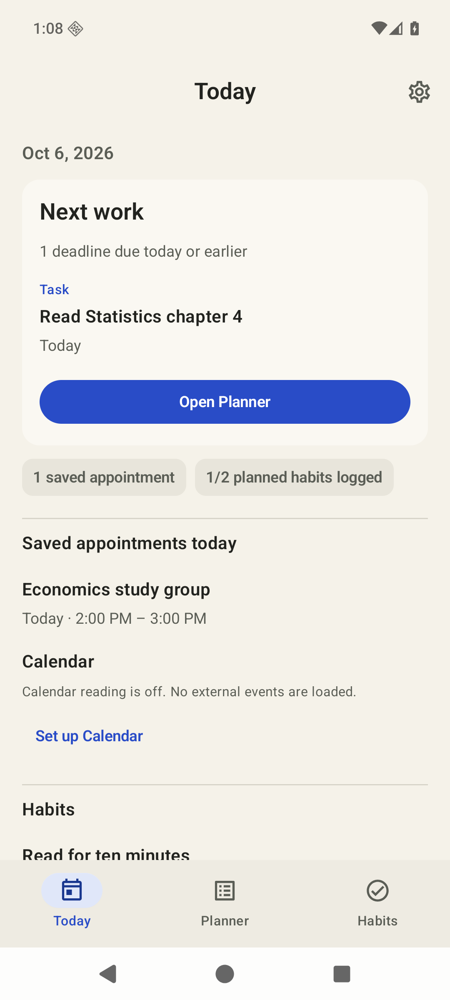
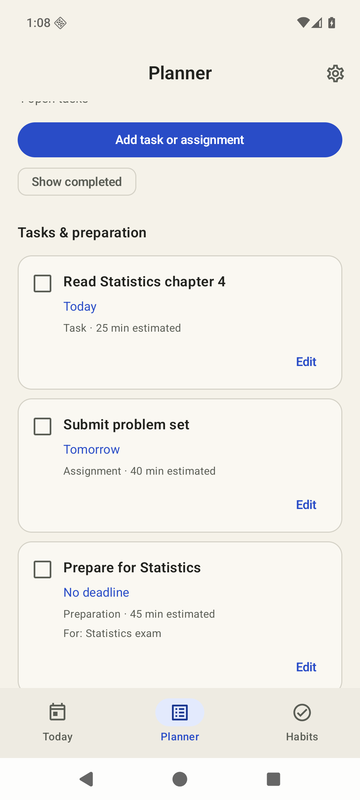
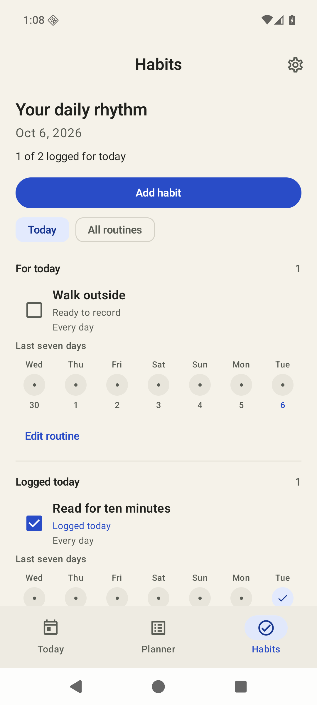
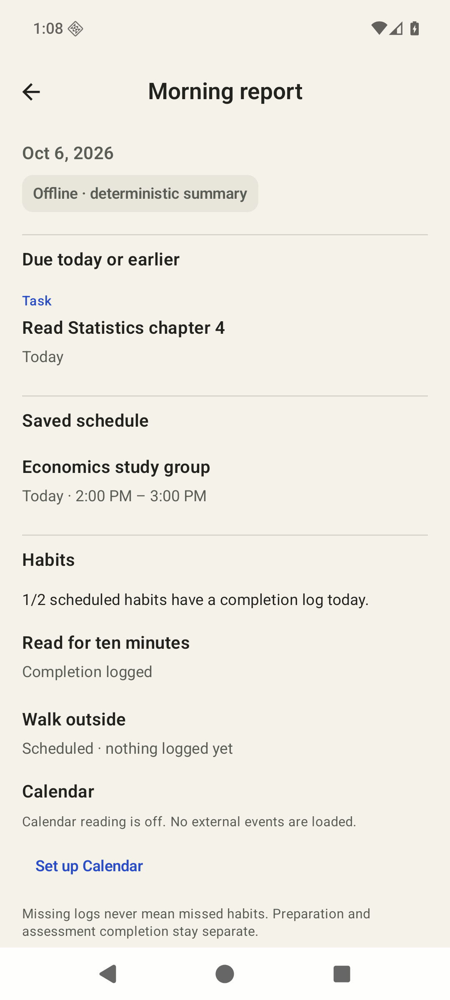
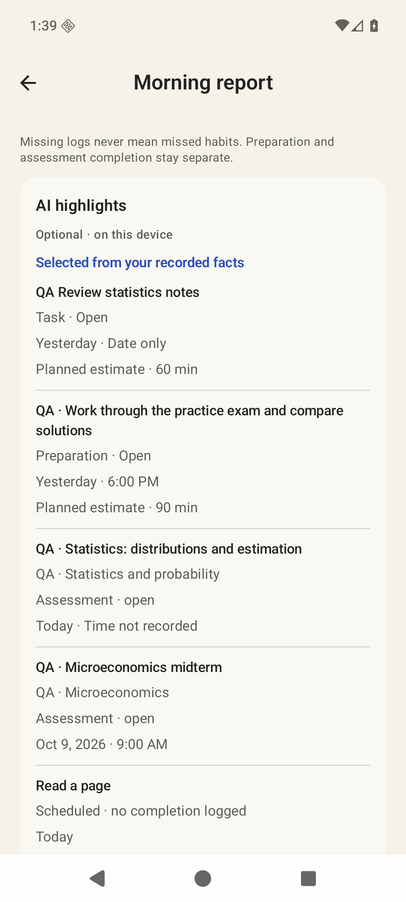
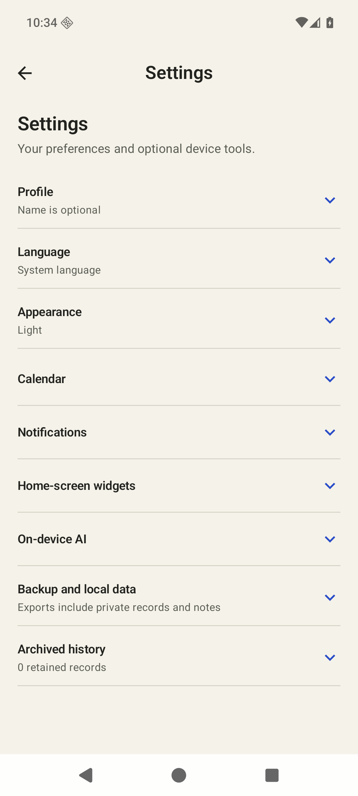

# 0.4.0 pre-release verification

This is the public summary of local Android verification completed on 6 October 2026 for the authorized 0.4.0 development pre-release. Release availability, download assets and their hashes are maintained in the [repository README](../../../README.md). These results establish the documented emulator checks and captured states; they do not establish physical-device or store readiness.

## Checks and runtime results

| Check | Result | Scope |
| --- | --- | --- |
| Portable core tests | 139 passed | Includes three checks that typed display references preserve model prompt/fingerprint behavior. |
| App unit tests | 3 passed | Formatting checks. |
| Affected Android instrumentation | 65 passed, no failures or skips, 84.393 s | Native LLDB attached before managed startup resumed. Editors, date/time/DST, workflow and recovery routes, Calendar, reminders, widgets, model storage, actual native/controller/report inference and six source-record renderer tests. |
| Asserted screenshot driver | 1 passed, 70.2 s | Real app composables in a synthetic test-host Activity; distinct from MainActivity and service acceptance. |
| Independent visual review | 69 states, 14 screen families; minimum 8.525/10, overall 8.6/10 | Scoring applies to the documented captured states. Corrected failures were replaced with fresh evidence. |

Actual CPU inference used the verified Liquid 230M and 2.6B model artifacts, downloaded separately from the APK. On the seven-item Morning fixture, the fast model completed an actual UI selection in **1.6 s**, and the balanced model completed an actual UI selection in **59.5 s**. A single bounded balanced recorded-report retry passed with **54.845 s** of generation time. Selected IDs were validated against original recorded facts; hidden reasoning was discarded, and planning files stayed unchanged.

The **original balanced recorded-report run failed at the fixed 90 s deadline**. That failure remains part of the result. Later successes do not erase it, explain its cause or promise a completion time on other devices. No data was removed and no generation deadline was increased to obtain a pass. These are runtime checks, not a model-accuracy or iPhone-parity benchmark. [On-device AI details](../../ANDROID-LOCAL-AI.md) describe the supported tiers and limits.

The same retained emulator was tested first with 6 GiB RAM and then restarted with 4 GiB, without resetting data or removing either model. Real device memory made the selected 2.6B tier unavailable, with its 5 GiB requirement and an explicit 230M alternative. Taking that alternative selected, verified and loaded the fast model. For the corrected gate capture, only the stopped app's isolated QA model-choice preference was restored to its prior balanced choice; RAM and load guards were not injected or bypassed.

An actual HOME/background transition and return unloaded the model/selection while retaining seven report source items and an explicit setup/reload path. Explicit reload succeeded. That observed UI flow does not prove precise in-flight cancellation timing; native load/generation cancellation, concurrent release, stale-fact refusal and reload have separate passing tests.

Synthetic private TLS bridge checks covered pairing, phone preview/confirmation, applied receipts, Cancel without sharing and explicit sharing of only one selected academic semester. They did not change personal assistant-client configuration or establish real LAN delivery. The synthetic pairing was revoked and the disposable listener stopped after QA.

Native LLDB was attached before every acceptance startup resumed through JDWP. ART/fork signals were configured, and timed inference had no native breakpoints. Initial attach stops and normal test-runner process exits were distinguished from crashes. No native crash was observed in the retained final crash evidence. Compressed system debug information had a host LLDB symbol limitation.

## Build and capture boundaries

UI acceptance spans six 0.4.0/code 4 iterations. The final 65-test run and full-record fast result used build `c4df4152`; the pre-publication UI candidate `93e2a2e5` changed only localized unsupported-tier readiness wording and received a fresh actual 4 GiB gate/recovery check. The whole 65-test suite was not repeated for that copy-only change. Core 139 and app 3 unit checks remained passing. Native prompts, grammar, budgets and fingerprint behavior were unchanged by the presentation corrections.

The representative images below are copied byte-for-byte from inspected synthetic captures. Their scopes are explicit:

| Image | Capture scope |
| --- | --- |
| Today, Work, Habits, Morning report | Build `b215ab52`: real app UI in a test-host Activity with an isolated synthetic repository, injected Calendar OFF and an absent model store. These images do not prove provider/network/model-service acceptance. |
| AI selected records | Build `c4df4152`: actual MainActivity and verified fast-model inference on retained synthetic records; this image shows part of six selected rows. |
| Settings | Build `c1ee8123`: actual MainActivity with synthetic data. This earlier 0.4 snapshot includes earlier minor copy, such as the archive count label; it is not relabelled as a final-build render. |

Light and dark captured UI states and large-text test-host states were reviewed. Actual MainActivity checks separately used **OS font scale 1.3** for the software-keyboard-visible task footer and native date/time dialogs. A parent Compose font override was not treated as proof of native dialog scaling.

## Limits

- Captures are English portrait emulator views at 1080 × 2400. Physical phones, tablets, landscape, RTL and every language/size combination remain unreviewed.
- Actual returned AI result captures were Morning-only. Evening and Weekly recorded-fact/missing-model UI and shared renderer behavior have separate captured/test coverage.
- Screenshots alone do not establish TalkBack order, keyboard traversal, complete contrast compliance, power-loss durability or physical-device performance.
- Framework integration tests passed, but actual pinned home-screen widget presentation, physical notification delivery, loaded external Calendar account flows and every backup/restore failure were not visually accepted.
- The 69-state visual result is a bounded review, not exhaustive coverage of all data, storage, network or permission conditions. Earlier failed or incorrectly named captures were excluded or superseded.

## Representative synthetic screens

| Today | Work and preparation | Habits |
| --- | --- | --- |
|  |  |  |

| Recorded Morning report | Actual fast-model selected records | Settings |
| --- | --- | --- |
|  |  |  |

[Architecture](../../ARCHITECTURE.md) · [Integration scope](../../ANDROID-INTEGRATIONS.md) · [On-device AI](../../ANDROID-LOCAL-AI.md)

## Final-artifact native follow-up

The publication build uses APK SHA-256 `f1f56ab31ce097c5921389aeff6d3645b7821cda4e01db0992dcb2f54f82053c`. A compiler path-mapping rebuild removed build-host path strings from native artifacts; sampling, grammar, budgets and UI behavior were unchanged. This follow-up preserves the earlier 139/3/65 results, visual review and actual capture-build identities instead of presenting them as newly rerun on this APK.

The retained API 36 ARM64 emulator was booted with 6 GiB RAM and four cores. The app and test APK were updated in place. Both model files and the same seven-item planning fixture were retained. Native LLDB was attached before managed startup resumed, with ART signals configured and no inference breakpoints or pauses.

| Focused final-artifact check | Result |
| --- | --- |
| Fast native 5 + controller 1 + recorded-report 1 | **7 passed**, no failures or skips; total **15.615 s**. Actual recorded-report generation completed in **2.556 s**. |
| Balanced recorded-report 1 | **Failed: fixed 90 s time limit**, measured generation **90.018 s**, total **94.417 s**. No repeat, fixture reduction or budget increase was used. |
| Actual MainActivity smoke | Today and On-device AI were visible under native LLDB. The exact APK's ARM64 native-library entry was confirmed mapped in the app. Its matching debug artifact resolves a remapped logical source name rather than a build-host source path. |

Safe input metrics remained seven facts, 179 system UTF-8 bytes and 988 user UTF-8 bytes (179/971 Unicode code points). The planning file was byte-identical before and after the focused checks. No crash appeared in the final crash buffer; normal test-runner exits were recorded separately. Cleanup detached LLDB, stopped only the task app/emulator, cleared debugger wait and removed only the owned debugger forwards while retaining the AVD, toolchain, private signing material, model files and planning data.

The new balanced timeout is an additional failed final-artifact result. The earlier original timeout, 59.5 s actual UI success and 54.845 s recorded retry remain distinct historical outcomes; their variation has no established causal explanation. The fast tier and recorded-fact fallback remain the practical development-preview path. The balanced tier has a known bounded-completion limitation, not a guaranteed runtime acceptance result. The unchanged-layout visual gate still applies to its documented earlier captures; this focused follow-up did not repeat the broad UI suite or add physical-device acceptance.
