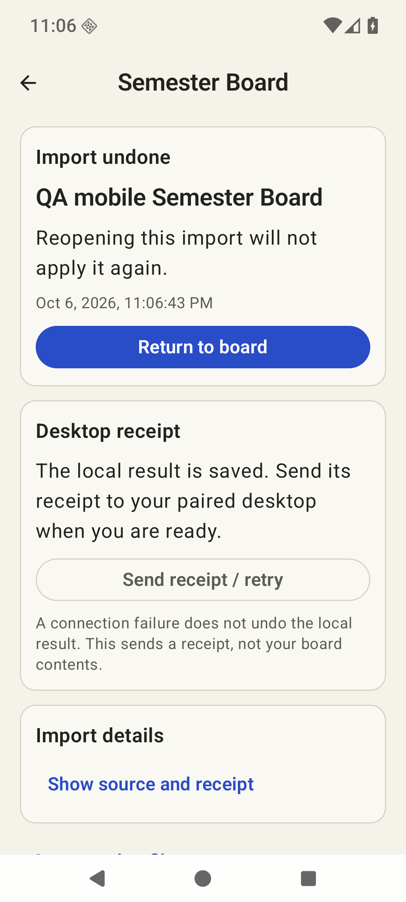

# 0.5.0 Semester Board verification

This is the public verification summary for the 0.5.0/code 5 development prerelease. It adds the iOS mobile **Planner → Semester** board and reviewed MCP 0.2 handoff, without sync. Release availability, APK/checksums and signing identity are maintained in the [repository README](../../../README.md). The source-only MCP package is separate from the Android APK. Neither contains iPhone source, credentials, model weights or a user workspace.

The board includes fixed source-ordered course/module labels, horizontal source-relative weeks, current-week navigation, custom status definitions/colors, read-only notes, exam/deadline markers and all-assessment states. Preparation remains an independent reviewed task. Raw iOS schemas 1–3 and typed Board proposals merge reviewed values, preserve omitted/history fields and use guarded Undo. [Contracts and scenarios](../../ANDROID-SEMESTER-BOARD.md).

## Checks

| Check | Result and scope |
| --- | --- |
| JVM core | 224 passed, zero failure/error/skip. |
| App unit | 3 passed. |
| Companion Python package/protocol | 84 passed, zero failure/error/skip; clean wheel/resources, synthetic TLS/HTTP and actual stdio. |
| Swift AcademicBridge compatibility | 63 passed; no iOS source change. |
| Board/projection instrumentation | Build 3: 8 passed, 121.020 s. |
| Neighbors | Build 3: 61 passed, 113.146 s; legacy v1, Calendar, reminders, widgets, model storage, reports, editors and recovery. |
| Actual fast Liquid inference | Build 3: 7 passed, 12.994 s; actual recorded-report generation 1.285 s on seven original facts. |
| Final affected UI instrumentation | Build 4: 13 passed, 169.926 s; Board/projection/legacy subset repeated after presentation changes. |
| Final capture driver | Build 4: 1 passed, JUnit 50.683 s, wall 52.977 s after managed resume; 24 real composable states in an isolated test-host Activity. |
| Independent visual review | 32 scoped states pass individually at ≥8.5; overall displayed 8.7, lowest 8.565. Includes eight actual MainActivity OS 1.3 states. |

Build 3 is app SHA-256 `7a7f25ac9fa5b7dfb081e393b6939db69eff6a01df4fa762c564a28ab1feee6c`. Build 4 changes presentation only and is the delivery APK: `5b7b046dbe77a6a004dbb9e7831e9e5af32b9b78589bf2fb51c88377b36e2567`, 34,747,849 bytes. Final test APK: `6d2e8762a1a63decae13032bd7bd656b2c179a4a7891db1548fa0e7b494acd64`. The 61 neighboring and seven inference checks were not rerun on Build 4; native/model/source contracts stayed unchanged. The 13 repeat a subset, not additional distinct tests. APK v2 signing uses the retained development certificate and 16 KiB library alignment passes. Archive audits found no private-key/build-host-path markers, model weights or runtime stores.

## Actual source and bridge flows

Native LLDB attached before JDWP resume for accepted runs, with ART/fork signals configured and no inference pauses. Actual captures check a live nonzero tracer per frame. Test-host font overrides do not establish OS font settings; actual MainActivity supplements used OS font scale 1.3 and the real software keyboard.

Opening the old workspace and file Read → Review → Cancel preserved schema-1 bytes. Deliberate Confirm preserved the exact dedicated original-version backup, every prior recorded field and both historical v1 receipts. Week status kept notes and assessments intact. Preparation was saved undated/zero-estimate, then completed separately without changing academic state. These earlier migration checks used Build 3; final bridge flows used Build 4.

The final phone paired over a disposable private TLS bridge and advertised both formats. Legacy v1 confirmed Apply and Undo reached the desktop. Context Review → Cancel uploaded nothing; explicit Confirm shared exactly the selected semester with disclosed notes/progress, excluding other semesters, planner/preparation, habits, Calendar, profile, source URLs, device/unknown metadata and credentials. A unique private preparation note stayed absent.

The Board proposal stayed pending after preview Cancel, then reached APPLIED after explicit Confirm. Its typed-file reopen matched an already authenticated ID/content fingerprint/opaque remote digest; a raw iOS file has no such desktop acknowledgement. Empty inbox refresh and cold restart retained source bytes and the mapping. With the owned desktop stopped, local Board Undo remained saved while its remote receipt stayed APPLIED, and the UI offered explicit Send receipt/retry. The same-state/certificate desktop restart and explicit manual retry delivered UNDONE at 21:08:13 UTC without changing planning bytes. The existing course was restored exactly, old tasks/assessments remained, and newly created course/assessment records stayed archived. Actual backup export passed: 38,020 bytes exactly matched the current schema-2 primary including both Board receipts, preserved workspace bytes and excluded credentials/model weights. An initial destination-unspecified automatic-approval rejection was resolved with one explicitly scoped owned-AVD/private-tmp retry; an early incomplete asynchronous read is retained separately. Owned cleanup is verified: pairing disconnected/revoked, zero paired/pending entries, listener/app/debugger/emulator stopped, debugger wait/forwards cleared and OS font restored to 1.0. Only owned transfer/UI files were removed; SDK/AVD/models/private signing/workspace/history/backups remain.

## Failures and limits

The first stale test build passed 5/7 with two import timeouts; the corrected freeze passed 7/8 with a raw legacy import failure. Explicit Main dispatcher handling and focused-input regression corrected the decode/focus boundary; fresh 8/8 and final 13/13 passed without relaxed timeouts. Both failed artifact identities/results remain separate.

System UI ANR-covered captures were rejected and replaced after restarting only the owned System UI process. The initial clean design round failed ten states below 8.5; revised screenshots passed. One official NDK 29 `lldb-server` exited 139, leaving the app stopped/untraced without a Java fatal. That debugger session was excluded, and final frames were recaptured after tracing was restored. Normal test-runner/intentional process exits and partial system symbols are separate from app failures.

This is bounded emulator acceptance, not physical-device or production readiness. Physical phones, real private-LAN routing, complete TalkBack traversal, tablets/landscape/RTL, every locale/font, thermal/battery behavior and prolonged idle delivery remain unverified. Framework Calendar/reminder/widget checks do not establish actual account data or physical notification delivery. Android still selects original recorded report facts; full iPhone prose-generation parity is outside this batch. The existing 2.6B model's bounded timeout variability remains documented in [local AI](../../ANDROID-LOCAL-AI.md); it was not retested for these Board/UI changes. Older 0.4 cannot read an edited schema-2 workspace, so retain version-specific backups.

## Representative synthetic screens

| Board, test-host | Actual OS 1.3 long-title detail | Actual OS 1.3 offline Undo |
| --- | --- | --- |
|  |  |  |

Exact private run proofs, all 32 accepted screenshots and rejected rounds are retained in the dated operator verification archive; representative synthetic screens and the public artifact/test scope are included here. Raw runtime/configuration data and credentials are excluded from this repository and release assets. No personal Codex/Claude configuration was modified.
